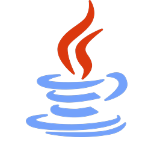
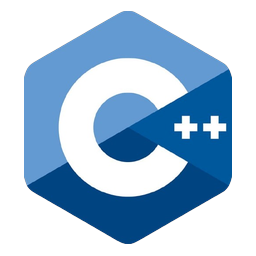
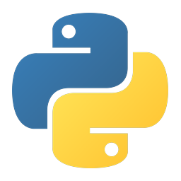
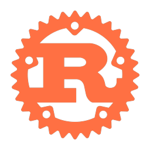
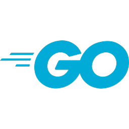
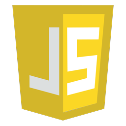
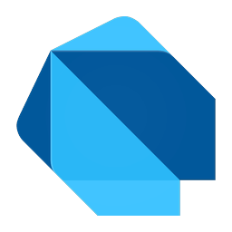

<div align="center">

# LeetCode Solutions

**1,076 problems. 9 languages. Two years, every month.**

&nbsp;
&nbsp;


&nbsp;&nbsp;
&nbsp;&nbsp;
&nbsp;&nbsp;
&nbsp;&nbsp;
&nbsp;&nbsp;
&nbsp;&nbsp;
&nbsp;&nbsp;
&nbsp;&nbsp;


### [**Browse all 1,076 problems**](docs/problems.md)

</div>

---

## Find a problem

- Press <kbd>t</kbd> on GitHub and type the number, e.g. `3551`.
- Or open the [problem index](docs/problems.md), sorted by number.

## Structure

```
1-250/
└── 1. Two Sum/
    ├── solution.java      one file per language
    ├── solution.cpp
    └── metadata.yaml      difficulty, tags, LeetCode link
```

## Contributing

Found a bug or a better approach? PRs are welcome. See the [contributor guide](CONTRIBUTING.md).

<div align="center">

<br>

**If this repo helped your prep, a ⭐ helps others find it.**

<sub>MIT License</sub>

</div>
